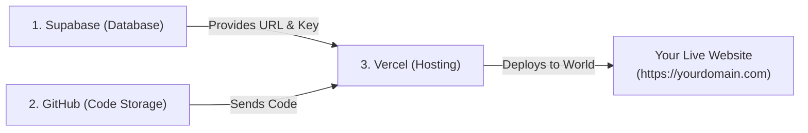

# Complete Beginner's Deployment & Database Setup Guide

> **Welcome, Shivkanya!** If this is your first time deploying a web application or setting up a database, this guide is designed specifically for you. Every single step is explained with exact button names, copy-paste commands, and tips so you can launch your portfolio with complete confidence.

---

## 🗺️ The Big Picture: How Deployment Works

Here is a simple breakdown of what we will do:



1. **Supabase**: Holds your database (case studies, profile, verified numbers, certifications) and your admin login.
2. **GitHub**: Stores your project code safely in the cloud.
3. **Vercel**: Connects to your GitHub, builds your Next.js application, and hosts it on the internet for free with high speed and automatic SSL security.

---

## 📌 Part 1: Supabase Database Creation & Setup (Free Tier)

Supabase gives you a free, hosted PostgreSQL database. Follow these steps:

### Step 1.1: Create a Supabase Account
1. Open your browser and go to [https://supabase.com](https://supabase.com).
2. Click **"Start your project"** or **"Sign Up"**.
3. Choose **"Continue with GitHub"** (recommended) or enter your email and a password.

---

### Step 1.2: Create a New Project
1. In the Supabase Dashboard, click the green **"New project"** button.
2. If prompted, select your free default organization.
3. Fill in the project details:
   - **Name**: `shivkanya-portfolio` (or any name you like)
   - **Database Password**: Type a strong password or click **"Generate a password"**. 
     > ⚠️ **Important**: Copy this password and save it in a safe place (like Notepad) for your reference.
   - **Region**: Choose the region closest to your audience (e.g., **`Central India (Mumbai) [ap-south-1]`**).
   - **Pricing Plan**: Keep it on **Free plan ($0/month)**.
4. Click **"Create new project"**.
5. Wait about 1 to 2 minutes while Supabase sets up your database. You will see a dashboard screen once it is ready.

---

### Step 1.3: Run the Database Schema & Seed Data
You do not need to write any SQL yourself! We already prepared the complete database schema in [`supabase/schema.sql`](./supabase/schema.sql).

1. In your Supabase left sidebar, click the **SQL Editor** icon (it looks like `>_` or a database terminal).
2. Click the **"New query"** button (or **"+"** tab).
3. On your computer, open the file:
   `c:\Users\shivkanya.byale\Downloads\Shivkanya\Portfolio\supabase\schema.sql`
4. Press `Ctrl + A` (select all) and `Ctrl + C` (copy).
5. Go back to your browser, click into the SQL Editor window, and press `Ctrl + V` (paste).
6. Click the green **"Run"** button in the bottom right (or press `Ctrl + Enter`).
7. You should see a message: **`Success. No rows returned`** in green at the bottom.

**What just happened?**
The script automatically:
- Created all 12 database tables (`profiles`, `key_metrics`, `services`, `work_steps`, `skill_groups`, `skills`, `experience`, `education`, `projects`, `certifications`, `testimonials`, `resume_files`, `contact_messages`).
- Configured strict **Row Level Security (RLS)**: Public visitors can only view published records; only you (the admin) can edit or delete.
- Created storage buckets (`portfolio-media` and `resumes`).
- Seeded your 4 verified numbers, DP-600 badge, 3 published case studies, and 1 draft case study (Banking RPA).

---

### Step 1.4: Verify Your Tables
1. In the left sidebar, click **Table Editor** (the spreadsheet/table icon).
2. You will see tables like `projects`, `profiles`, `key_metrics`, `certifications`.
3. Click on `projects` — you should see your 4 case studies already loaded!

---

### Step 1.5: Create Your Admin Login User
This is the single admin account you will use to log into `https://yourdomain.com/admin`.

1. In the Supabase left sidebar, click **Authentication** (the user/lock icon).
2. In the top tabs, click **Users**.
3. Click the **"Add user"** button -> select **"Create user"**.
4. Fill in:
   - **User Email**: Your personal email (e.g. `shivkanya.byale@gmail.com`).
   - **User Password**: Choose a secure password that you will use to log into your portfolio admin panel.
   - **Auto Confirm User?**: Make sure this toggle is turned **ON** (green).
5. Click **"Create user"**.
6. You will now see your email listed in the Users table!

---

### Step 1.6: Copy Your Supabase API Keys
You need two values to connect your Next.js website to Supabase:

1. In the left sidebar, click the **Settings** icon (gear icon at the very bottom).
2. Under "Configuration", click **API**.
3. Look for the **"Project URL"**:
   - Click the **Copy** button next to the URL (it looks like `https://abcdefghijklm.supabase.co`).
4. Look for the **"Project API keys"** section:
   - Find the key labeled **`anon` `public`**.
   - Click the **Copy** button next to it.
5. Save both in a temporary Notepad file:
   ```text
   NEXT_PUBLIC_SUPABASE_URL=https://your-project-id.supabase.co
   NEXT_PUBLIC_SUPABASE_ANON_KEY=eyJhbGciOiJIUzI1NiIsInR5cCI6IkpXVCJ9...
   ```

---

## 📌 Part 2: Put Your Project on GitHub

Vercel deploys directly from GitHub. Whenever you update your code and push to GitHub, Vercel automatically updates your website.

### Step 2.1: Create a GitHub Account
If you don't have one:
1. Go to [https://github.com](https://github.com) and sign up for free.

---

### Step 2.2: Create a New GitHub Repository
1. Log in to GitHub.
2. In the top right corner, click the **"+"** icon -> **"New repository"**.
3. Fill in:
   - **Repository name**: `shivkanya-portfolio`
   - **Visibility**: Choose **Public** (good for recruiter visibility) or **Private** (either works with Vercel).
   - Leave "Add a README file", ".gitignore", and "license" **UNCHECKED** (we already have them).
4. Click **"Create repository"**.
5. Keep this page open; you will see commands under **"…or push an existing repository from the command line"**.

---

### Step 2.3: Push Code from Your Computer to GitHub
> 🛡️ **Safe & Secure**: Your `.gitignore` file is already completely configured! It automatically ignores:
> - Private environment files (`.env.local`, `.env`) so your secret database passwords are never uploaded.
> - Heavy dependency folders (`node_modules/`) and build outputs (`.next/`).
> - Local temporary files. Only clean source code and `.env.example` will be pushed.

Open PowerShell on your computer in your portfolio folder (`c:\Users\shivkanya.byale\Downloads\Shivkanya\Portfolio`) and run these commands:

```powershell
# 1. Ensure Git and Node are in your PowerShell PATH
$env:PATH = "$env:LOCALAPPDATA\Programs\Git\cmd;$env:LOCALAPPDATA\Programs\nodejs;$env:PATH"

# 2. Check git status to see what is tracked (notice .env.local and node_modules are safely ignored!)
git status

# 3. Add all project files
git add .

# 4. Create initial commit
git commit -m "Initial commit of Shivkanya Byale portfolio"

# 5. Set branch to main
git branch -M main

# 6. Link to your GitHub repository (replace with your actual GitHub repo URL from step 2.2)
git remote add origin https://github.com/YOUR_GITHUB_USERNAME/shivkanya-portfolio.git

# 7. Push code to GitHub
git push -u origin main
```

*(Note: If Git asks you to sign in, click "Sign in with your browser" and authorize GitHub.)*

Once done, refresh your GitHub page in your browser. You will see all your portfolio code uploaded!

---

## 📌 Part 3: Deploy to Vercel (Free Hosting)

Vercel is the creator of Next.js and provides free, ultra-fast hosting.

### Step 3.1: Log in to Vercel
1. Go to [https://vercel.com](https://vercel.com).
2. Click **"Sign Up"** or **"Log In"**.
3. Select **"Continue with GitHub"** (this links your accounts automatically).

---

### Step 3.2: Import Your Repository
1. Once logged into the Vercel dashboard, click the **"Add New..."** button (top right) -> select **"Project"**.
2. Under "Import Git Repository", find `shivkanya-portfolio`.
3. Click the **"Import"** button next to it.

---

### Step 3.3: Configure Environment Variables
On the configuration screen:
1. **Project Name**: Keep as `shivkanya-portfolio` (or your choice).
2. **Framework Preset**: `Next.js` (detected automatically).
3. **Root Directory**: `./` (leave default).
4. Click to expand the **"Environment Variables"** accordion section.
5. Add these variables (copy from Part 1, Step 1.6):

| Key | Value | Description |
| :--- | :--- | :--- |
| `NEXT_PUBLIC_SUPABASE_URL` | `https://your-id.supabase.co` | Your Supabase project URL |
| `NEXT_PUBLIC_SUPABASE_ANON_KEY` | `eyJhbGciOi...` | Your Supabase public anon key |
| `NEXT_PUBLIC_SITE_URL` | `https://shivkanya-portfolio.vercel.app` | Leave as your Vercel URL (or custom domain if you have one) |

*(Note: Click the **"Add"** button after typing each key/value pair).*

---

### Step 3.4: Click Deploy!
1. Click the blue **"Deploy"** button.
2. Vercel will now:
   - Download dependencies
   - Compile TypeScript
   - Pre-render static pages
   - Generate SEO metadata
3. After about 60 to 90 seconds, confetti will burst across the screen:
   🎉 **"Congratulations! You just deployed a new Project to Vercel."**
4. Click the preview screenshot or the link to view your live portfolio website!

---

## 📌 Part 4: Connecting a Custom Domain (Optional)

If you own a domain like `shivkanyabyale.com` (from GoDaddy, Namecheap, Hostinger, Squarespace, etc.):

1. In your Vercel Project Dashboard, click **Settings** (top tab) -> **Domains** (left menu).
2. In the input box, type your domain (e.g., `shivkanyabyale.com`) and click **Add**.
3. Choose the recommended option: **Add `shivkanyabyale.com` and redirect `www.shivkanyabyale.com` to it**.
4. Vercel will show you the exact DNS records to add:
   - **Type**: `A` | **Name**: `@` | **Value**: `76.76.21.21`
   - **Type**: `CNAME` | **Name**: `www` | **Value**: `cname.vercel-dns.com`
5. Go to your domain registrar (where you bought your domain):
   - Open **DNS Management** / **Manage DNS**.
   - Add the two records above.
   - Save changes.
6. Within 10 to 30 minutes, Vercel will detect the records, automatically generate a free SSL certificate, and your custom domain will be secure and live!

---

## 📌 Part 5: Testing & Verifying Everything

Once deployed, visit your live website and verify these key items:

- [ ] **Home Page**:
  - Name, DP-600 badge, headline, and value statement display correctly.
  - Key numbers strip displays the 4 verified facts: `3+`, `5+`, `10+`, `DP-600`.
- [ ] **Download Resume Dropdown**:
  - Click "Download Resume" in the hero — verify the dropdown appears with versions (*Power BI Focus*, *Power Platform Focus*, *Business Analyst Focus*, *Complete CV*).
- [ ] **Interactive Skills Filter**:
  - Scroll to **Skills** and click **DAX** or **Power BI** — verify it scrolls and filters the **Projects** section.
- [ ] **Case Study Detail Pages**:
  - Click on any project card (e.g. *Multi-Entity Consolidated Finance Analytics*).
  - Verify the 10 structured sections load cleanly.
- [ ] **Printable Resume**:
  - Visit `https://your-site.vercel.app/resume`.
  - Click "Print / Save as PDF" to preview the print layout.
- [ ] **Admin Login (`/admin`)**:
  - Visit `https://your-site.vercel.app/admin`.
  - Enter the email and password you created in Supabase (Part 1, Step 1.5).
  - You will enter the Admin CMS Dashboard where you can edit projects, toggle drafts to published, and manage skills!

---

## 📌 Part 6: How to Update Your Website in the Future

### 1. Making Content Changes (No Coding Needed!):
- Simply log into `https://yourdomain.com/admin`.
- Edit text, add projects, or update your "Currently Learning" line.
- Changes save directly to Supabase and show up on your live site!

### 2. Making Code Changes:
Whenever you edit code on your computer:
```powershell
git add .
git commit -m "Update portfolio styling"
git push
```
Vercel automatically detects the new commit and rebuilds your live site within 60 seconds!

---

## ❓ Common First-Time Questions

### Q: Does this cost anything?
**No.** Supabase has a generous Free Tier (500MB database, 1GB storage, 50,000 active users) and Vercel has a generous Free Hobby Tier (unlimited deployments, free SSL, fast global CDN). You will pay $0.

### Q: What if I don't have a custom domain yet?
You don't need one to get started! Vercel gives you a free URL (e.g., `https://shivkanya-portfolio.vercel.app`) that is fully functional, secure, and ready to send to recruiters immediately. You can attach a custom domain whenever you buy one later.

### Q: Why is the Banking RPA project not visible on the public site?
It is intentionally saved as a **`draft`** so client confidentiality and your placeholders remain private. You can preview it at `/projects/banking-process-automation-rpa?preview=true` or edit it in `/admin` whenever you are ready to publish it.

---

### Need Help?
- Refer to [`ADMIN_GUIDE.md`](./ADMIN_GUIDE.md) for how to use the admin dashboard.
- Refer to [`PLACEHOLDERS.md`](./PLACEHOLDERS.md) for checklist items to fill in before sending to recruiters.
